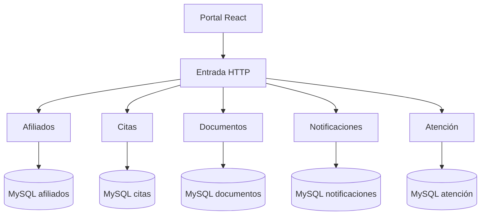

# Arquitectura de Virelia

Cinco procesos independientes y cinco bases en una sola instancia. El código de autenticación de sesión reside en Afiliados. El resto valida la cookie mediante HTTP interno y una clave privada del entorno. El gateway no acepta claves internas del cliente ni expone esas rutas.

## Interfaz

React + Vite; navegación con useState y fragmentos de URL, siguiendo la referencia BOGOBIKER. Navbar recibe props, Layout recibe children. Las páginas públicas y personales comparten componentes de formulario, mensajes, vacíos y carga. Los registros personales no se solicitan para construir la página pública. Al ingresar, la cuenta controla su información; no existe un modo administrador.

## Datos y consistencia

SQL parametrizado con mysql2/promise. Las reservas de citas bloquean el horario dentro de una transacción. Reprogramar reserva el nuevo y libera el anterior en la misma transacción. La restricción de titular se aplica en el servidor, no solo ocultando botones.

## Eventos

El productor guarda su outbox en la transacción. Un trabajador hace la entrega HTTP a Notificaciones y confirma solo cuando se recibió. El consumidor conserva un identificador único. No hay confirmaciones simuladas de correo: sin proveedor SMTP se indica Sin configurar.

## Protección y límites

Tokens aleatorios guardados como hash; cookie HttpOnly y SameSite=Lax; scrypt para contraseñas. Las operaciones de datos usan siempre el titular de la sesión validada. Hay comprobación de origen y límite de tamaño JSON. No se ha realizado una auditoría de seguridad de producción. Antes de uso real se requieren verificación de identidad/afiliación, recuperación de cuenta, controles operativos, HTTPS, permisos MySQL por servicio y revisión de protección de datos.
